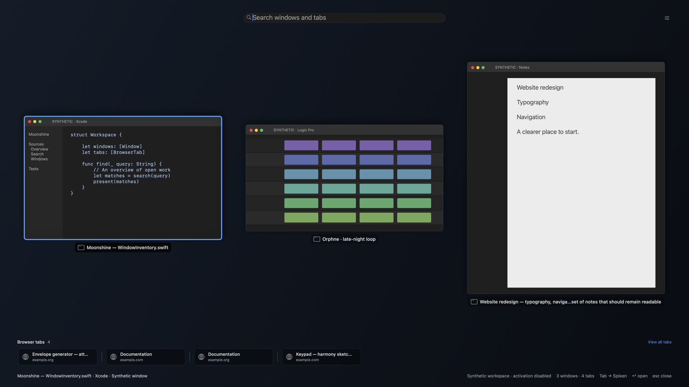

# Moonshine

A native macOS overview for finding the windows and browser tabs you already have open.

Press **Control–Option–M**, start typing, and jump to the exact window or tab with Return. Moonshine combines a Mission Control-style canvas, local window previews, fast title matching, and optional semantic search. It does not search the web or open new URLs.



*Preview uses fictional windows and example URLs. No personal desktop or browsing data is included.*

**Works on its own.** You can also pair it with [Spleen](https://github.com/d4j3y2k/spleen), a separate app for returning to AI conversations. With both installed, **Tab / Shift–Tab** carries your current search between them. Neither app requires the other, an API key, or a subscription for local navigation.

> **Experimental, built from source.** Tested on Apple silicon with macOS 26. The deployment target is macOS 14; earlier systems and Intel Macs have not been independently verified. There is no notarized download or packaged Safari extension yet.

## Install

Requires **Xcode 26 or later** with its macOS SDK selected as the active developer toolchain, plus **Python 3** for preparing the optional browser extensions. There are no third-party Swift dependencies. Node.js is needed only for browser-extension tests.

```sh
git clone https://github.com/d4j3y2k/moonshine.git
cd moonshine
./scripts/install.sh
open "$HOME/Applications/Moonshine.app"
```

The installer builds locally, verifies the app's signature, and copies it to `~/Applications`. It needs no administrator access. Quit any running Moonshine before installing or updating. To build without installing, run `./scripts/build.sh` and open `build/Moonshine.app`.

On first launch, open **Settings** from the gear or menu bar:

| Permission or option | What it enables |
| --- | --- |
| Accessibility | Focus the exact native window you select. Without it, some window metadata may still be visible. |
| Screen Recording (optional) | Local cached window previews. Images are never sent to OpenAI. |
| Chrome Automation (optional) | Find and activate ordinary Chrome tabs; allow the macOS Automation prompt after enabling it. |
| Browser extension (optional) | Safari tabs, explicit Chrome profile pairing, and opt-in page labels. |
| OpenAI refinement (off by default) | Semantic matching using your own API key and API access. Local search needs neither. |

Builds use ad-hoc signing unless you set `MOONSHINE_SIGN_IDENTITY` to your own certificate. After rebuilding, macOS may ask you to grant permissions again. The installer does not change Gatekeeper, grant permissions, or install browser extensions for you.

See the [setup guide](docs/SETUP.md) for updates, permissions, optional API setup, and removal.

## Use

- **Control–Option–M** or the menu bar opens the overview. Settings offers alternative shortcuts.
- Type to filter all open windows and tabs. Exact names, prefixes, initials, and small typos work locally.
- Use **arrow keys** to select, **Return** to activate, and **Escape** to return to the preceding app. Clicking a result also activates it.
- **View all tabs** expands the browser strip. Clearing the query restores the overview.
- **Tab / Shift–Tab** continues the query in Spleen if installed. Settings keeps normal Tab focus navigation.
- **Command–comma** opens Settings. Standard copy, paste, select-all, and undo shortcuts work in search.

Windows keep their proportions as they zoom into the overview; Reduce Motion uses a short fade. Previews are cached stills and can be unavailable for minimized, protected, or offscreen windows. Browser tabs use title/domain cards. If a selected target closes or stops matching, Return never silently opens a replacement.

## Use with Spleen

[Install Spleen](https://github.com/d4j3y2k/spleen#install) separately and open each app once. Both can live in `~/Applications`; no shared folder, server, account, or pairing code is needed for this connection.

| App | Searches | Default shortcut |
| --- | --- | --- |
| Moonshine | Open native windows and ordinary browser tabs | Control–Option–M |
| Spleen | Saved and locally discovered AI conversations | Control–Option–Space |

Type in either app and press **Tab** to transfer the exact text to the other, ready to continue typing. A closed companion starts automatically. Each app retains its own results, permissions, settings, and API configuration. If the companion is absent, the search stays available with an installation message. The integration transfers the query locally; it does not share browsing inventories, conversation excerpts, keys, or stored history. The receiving app's own remote-processing settings still apply.

See the [connection guide](docs/INTEGRATION.md) for details and troubleshooting.

## Browser tabs and page context

**Chrome:** Enable Chrome Automation in Settings for the simplest setup. Alternatively, load `build/ChromeExtension` from Chrome's Extensions page using Developer mode → Load unpacked.

**Safari 26:** In Safari Settings → Developer, choose **Add Temporary Extension…** and select `build/SafariExtension`. Enable it for the intended ordinary profile and grant website access when Safari requests it. Safari may require its developer features and unsigned-extension approval. Temporary extensions expire on Safari quit or after 24 hours; this is a development installation, not a permanent Safari package.

For either extension, copy the **pairing code** from Moonshine Settings into its toolbar popup and choose **Connect**. This code is separate from any API key. Pair each desired browser profile. When Chrome extension clients are connected, their inventory replaces Chrome Automation's inventory; unpaired Chrome profiles will not appear.

The extension excludes private tabs and defaults to titles and URLs. Optional **Enable for this site** asks for permission to read bounded page descriptions, headings, and button labels on that site. **Preview collected context** shows the labels, and **Stop using this site** clears them. Turn on **Use page context** in Moonshine Settings to include those labels in matching. With OpenAI refinement also enabled, they enter remote requests too. Page-context support in Safari still needs broader acceptance testing.

## Privacy

Local search and navigation send no data to OpenAI. Semantic refinement is **off by default** and requires your own key and an explicit Settings toggle. When enabled, typing sends the query, bounded window/tab titles, application names, item kinds, and sanitized HTTP(S) URLs to OpenAI's Decisions API. URL credentials, query strings, and fragments are removed; **titles, URL paths, queries, and opted-in page labels can still contain private information**.

Screenshots, clipboard contents, form values, full page bodies, and browsing history are not included in these requests. Previews and the current inventory stay in memory. Settings retain preferences, the chosen key-file path, and a random browser pairing code; the extension stores its pairing configuration and site choices locally. The API key is read from your private file or an explicitly supplied process environment variable. It is not bundled with the app or sent to the extension.

The browser bridge listens only on `127.0.0.1:49731`, authenticates with the pairing code, rejects webpage origins, bounds messages, and expires stale clients. It can synchronize open-tab metadata and activate existing tab IDs; it cannot execute shell commands or open arbitrary URLs. The code is a credential: do not post it in issues or screenshots.

See [security reporting and boundaries](SECURITY.md). Security checks reduce risk; they are not a guarantee that all possible vulnerabilities or sensitive inputs are excluded.

## Development

```sh
./scripts/test.sh                         # Swift and browser tests; no live API calls
./scripts/build.sh
mkdir -p build/verification/public
build/Moonshine.app/Contents/MacOS/Moonshine --demo --self-test "$PWD/build/verification/public"
```

The native self-test uses synthetic fixtures, disables real activation, and renders without taking keyboard focus. Tests cover exact identity, stale results, private-tab exclusion, page-context boundaries, bridge authentication, and query handoff. See [verification](docs/verification.md) and [implementation notes](docs/implementation.md).

Optional live API checks are explicit commands documented in the setup guide. Keep real evaluation fixtures and diagnostic output in ignored local directories. Never commit credentials, live screenshots, personal browsing data, or build artifacts.

## License

[MIT](LICENSE). Moonshine is an independent project. Apple, browser, and OpenAI product names identify compatible technologies and belong to their respective owners.
